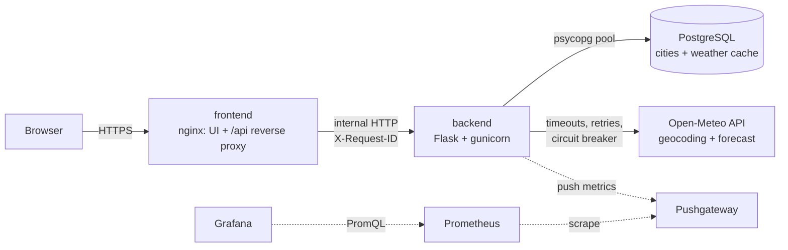
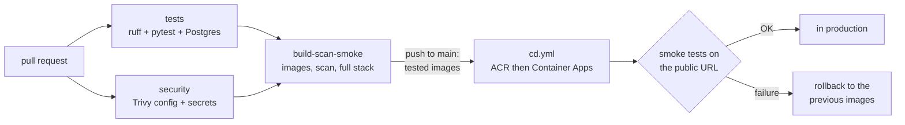

# Météo des villes: a 3-tier app on Azure

Add cities, see their current weather. Three containerised services (**frontend** nginx, **backend** Flask,
**database** PostgreSQL) and one **external API** (Open-Meteo), treated as a dependency that can fail.

Deployed on Azure Container Apps (public frontend, internal backend) with managed PostgreSQL. Every push to
`main` is tested, then deployed by GitHub Actions.

**Live application:** https://meteo-frontend.bluemeadow-0d1feb28.francecentral.azurecontainerapps.io


## How the brief is covered

| Requirement | Where |
|---|---|
| UI + backend, public URL | nginx UI + Flask API + PostgreSQL, public frontend on Azure Container Apps |
| Fully containerised | 3 Dockerfiles + [`docker-compose.yml`](docker-compose.yml) ([Run locally](#run-locally)) |
| Automated CI/CD | [`ci.yml`](.github/workflows/ci.yml) + [`cd.yml`](.github/workflows/cd.yml): lint, tests, Trivy, end-to-end smoke tests, deploy, automatic rollback ([CI/CD](#cicd)) |
| Cloud deployment, container registry | Azure Container Apps + Azure Container Registry ([Azure bootstrap](#azure-bootstrap)) |
| Reliability under failure | timeouts, retries, circuit breakers, degraded mode, probes, failure drills ([Technical choices](#technical-choices), [Failure drills](#failure-drills)) |
| Visibility (logs, metrics) | JSON logs with request id, Log Analytics queries, Prometheus + Grafana, alerts ([Observability](#observability-and-alerting)) |
| Secure configuration and secrets | `.env` git-ignored, Container Apps secrets, OIDC (no Azure password in GitHub), GitHub secrets for CI ([GitHub secrets](#github-secrets)) |
| Scalability and load | stateless services, autoscaling 1→8 / 1→5, connection budget, k6 load test ([Scalability](#scalability), [Load test](#load-test-and-autoscaling)) |
| Known limitations and improvements | [Known limits](#known-limits), [Observability limits](#observability-limits) |

## Architecture



| Service | Role | Public |
|---|---|---|
| `frontend` | Serves the static UI, proxies `/api/*`, sets security headers and `X-Request-ID` | Yes (single entry point) |
| `backend` | REST API, cache and degraded mode, runs migrations at startup | No (internal) |
| `db` | Followed cities and last known weather | No |

## Run locally

Requirements: Docker with Docker Compose.

```bash
cp .env.example .env        # then change POSTGRES_PASSWORD and GRAFANA_ADMIN_PASSWORD
docker compose up --build   # app: http://localhost:8080
```

If port 8080 is already taken (Jenkins, for example), set `FRONTEND_HOST_PORT=8088` in `.env`.
On Windows PowerShell, use `copy .env.example .env`.

Grafana: http://localhost:3000, Prometheus: http://localhost:9090 (see [Observability](#observability-and-alerting)).

## CI/CD




- **Triggers**: a pull request runs the CI only; a push to `main` also deploys. This time-boxed solo project
  commits to `main`; in a team, `main` would be protected (pull request + required checks).
- **Two workflows**: [`ci.yml`](.github/workflows/ci.yml) tests, builds and scans;
  [`cd.yml`](.github/workflows/cd.yml) is a reusable workflow (`workflow_call`) that the CI calls on `main`.
- **Skip the deployment**: put `[skip-cd]` in the commit message (for example a docs-only change).
- **We deploy exactly what was tested**: the images built by `build-scan-smoke` are passed to the CD as an
  artifact, not rebuilt. They are tagged with the commit SHA, and `/api/info` returns it: the smoke test
  checks that the public URL serves the new commit.
- **Zero downtime**: in single revision mode, the old revision keeps serving until the new one is ready.
  Backend first (it runs the migrations), then frontend.
- **Automatic rollback**: if a revision does not start or the smoke test fails, the CD puts back the images
  that were running before. Manual rollback:
  `az containerapp update -n meteo-backend -g rg-sre-meteo --image acrsremeteokoussay.azurecr.io/meteo-backend:<sha>`.
- **Observability**: the CD also rebuilds Prometheus and Grafana, only when `observability/` changed.
- **One deployment at a time**, never cancelled by a newer push.
- **Actions pinned by SHA** (with the version in a comment) and updated weekly by
  [Dependabot](.github/dependabot.yml), like the Python packages and the base images.

### GitHub secrets

| Secret | Used by | Value |
|---|---|---|
| `AZURE_CLIENT_ID`, `AZURE_TENANT_ID`, `AZURE_SUBSCRIPTION_ID` | CD (`production` environment) | printed by `infra/github-oidc-setup.ps1` |
| `CI_DB_USER`, `CI_DB_PASSWORD` | CI: throwaway PostgreSQL of the tests | any value, letters and digits only |
| `CI_GRAFANA_PASSWORD` | CI: Grafana admin of the smoke test | any value |

No Azure password is stored in GitHub: the CD logs in with **OIDC**. GitHub presents a signed token
("this repository, environment production") that Azure exchanges for short-lived access. The pipeline
identity only has `AcrPush` on the registry and `Contributor` on the app resource group. The three
`AZURE_*` values are identifiers, not passwords.

## API

| Method and route | Role | Codes |
|---|---|---|
| `GET /api/weather` | The visitor's cities **with** their weather, in one call (used by the UI) | 200, 400, 503 |
| `GET /api/weather/here?lat=&lon=` | Weather at the visitor's position (rounded to ~1 km) | 200, 400, 503 |
| `GET /api/cities` | The visitor's cities | 200, 400, 503 |
| `GET /api/geocode?q=sf` | Suggestions while typing (8 max, with region for homonyms) | 200, 400, 503 |
| `POST /api/cities` `{"name": "Lille", "id": 2998324}` | Adds a city. `id` (optional) is the chosen suggestion; without it, first geocoding result | 201, 400, 404, 409, 503 |
| `DELETE /api/cities/{id}` | Removes a city from the visitor's list | 204, 400, 404 |
| `GET /api/cities/{id}/weather` | Current weather of one city | 200, 404, 503 |
| `GET /api/info` | Version, environment, replica and revision that answered | 200 |
| `GET /healthz` | Liveness: the process answers (no dependency checked) | 200 |
| `GET /readyz` | Readiness: the database answers (+ circuit and pool state) | 200, 503 |

Errors are JSON: `{"error": "<code>", "message": "...", "request_id": "..."}`.

- **Per-visitor lists**: list routes expect an `X-Visitor-Id` header, a UUID generated by the browser and
  kept in `localStorage`. It separates lists without user accounts; it is not authentication. **Places**
  and their **weather cache** are shared: 100 visitors following Paris means one "Paris" row and one
  weather API call per period.
- **Weather at my position**: the browser asks for consent, rounds the coordinates to 0.01° (~1 km), the
  backend rounds them again. They are never stored nor logged (only the path is logged). Cached 10 min in
  memory per rounded position.
- **Suggestions**: the UI waits 250 ms after the last keystroke and cancels the previous request. Backend:
  process memory → **shared cache in the database** (`geocode_cache`, 24 h) → Open-Meteo, with **one call at
  a time per text** (single-flight). API down: the last known result is served, even expired. When adding
  a city, the backend never trusts coordinates sent by the browser: it looks up the suggestion by `id`.
- **Tech panel**: add `?tech` to the URL to show version, replica, and a button that sends 20 requests and
  counts answers per replica (to show scale-out).
- **Browser cache**: `index.html`, JS and CSS are served with `expires -1` (ETag revalidation): after a
  deployment, nobody keeps old JavaScript against a new API.

Each weather entry has a `source`:

| `source` | Meaning |
|---|---|
| `cache` | Valid cache (under 10 min): no external call |
| `live` | Cache expired, refreshed just now by this instance |
| `refreshing` | Cache expired, another instance is refreshing it: the last value is served |
| `stale` | Refresh impossible (API down, circuit open or time budget spent): last known value |

## Technical choices

- **Static frontend served by nginx**, which is also the reverse proxy: one public entry point, no CORS,
  backend not exposed, security headers (CSP...) and `X-Request-ID` set at the edge.
- **End-to-end correlation**: nginx generates (or keeps) `X-Request-ID`, the backend reuses it in all its
  logs and error responses. Both services log JSON to stdout.
- **The external API is a fragile dependency**:
  - short timeouts (connect 1.5 s, read 2.5 s); 2 retries on connection errors and 5xx only (not on read
    timeout, which would double latency, nor on 429, which would worsen the quota);
  - circuit breaker: after 3 consecutive failures, no call for 30 s, fail fast. **One breaker per API**
    (geocoding, forecast): rejected suggestions do not block weather refreshes;
  - weather cache in the database (10 min); degraded mode: API down → last known weather, marked `stale`.
- **Separate probes**: `/healthz` checks nothing external (otherwise a database outage would restart every
  replica in a loop); `/readyz` checks the database; the weather API is not in readiness because its
  absence is handled by degraded mode.
- **Versioned migrations** (`backend/app/migrations/*.sql`) applied at startup under a Postgres advisory
  lock, so several replicas can start at the same time.
- **Bounded connection pool**: a saturated or unreachable database gives a fast 503, not a hang.
- **12-factor configuration**: everything through environment variables; secrets in `.env` (git-ignored)
  locally, in Container Apps secrets on Azure.
- **Non-root containers**: user `10001` for the backend, `nginx-unprivileged` for the frontend.

## Scalability

Frontend and backend are **stateless** (all state is in PostgreSQL): replicas are added without code
changes. More replicas move the bottleneck to the database and the external API; three mechanisms protect
them.

**1. Database connection budget.** Each backend replica opens at most
`GUNICORN_WORKERS × DB_POOL_MAX_SIZE` connections (2 × 2 = 4). We must keep:

```
max_replicas × connections_per_replica  ≤  database_user_connections − margin (migrations, admin)
```

| Azure PostgreSQL tier | User connections | Max backend replicas (4 each, margin 3) |
|---|---|---|
| Burstable B1ms | 35 | 8 |
| Burstable B2s | 414 | 100+ (the database CPU becomes the limit) |

The autoscaling maximum follows this calculation: otherwise scaling *breaks* the app (refused connections)
instead of helping. Two connections for four threads is enough because SQL queries last a few
milliseconds. Saturation shows in `/readyz` → `info.db_pool.requests_waiting`.

**2. No N+1.** The UI calls `GET /api/weather`: one SQL query (cities joined with cache) for all cities,
instead of 1 + N HTTP calls and 2N SQL queries.

**3. No stampede when the cache expires.** The first request takes a 10 s **lease** with an atomic `UPDATE`;
the others serve the last value (`refreshing`). Result: one external call per city per 10 minutes,
whatever the load. If the lease holder crashes, the lease expires by itself.

**Time budget per request**: `/api/weather` stops refreshing after 4 s (`REFRESH_BUDGET_S`) and serves the
cache, so the request stays under the nginx timeout (15 s) even if the weather API is slow.

Autoscaling rules and load test results: [Load test and autoscaling](#load-test-and-autoscaling).

## Load test and autoscaling

### Scaling rules

HTTP scaling, on concurrent requests per replica:

| Service | Replicas | Scale-out threshold | Why |
|---|---|---|---|
| `meteo-backend` | 1 → 8 | 10 concurrent requests | 2 workers × 4 threads = 8 requests in parallel per replica; max 8 = PostgreSQL connection budget ([connection budget](#scalability)) |
| `meteo-frontend` | 1 → 5 | 50 concurrent requests | nginx is light: static files and API proxy |

`min-replicas = 1`: no cold start for the first visitor. Extra replicas are removed about 5 minutes after
the load ends.

### Scenario

[`charge.js`](loadtest/charge.js) ([k6](https://grafana.com/docs/k6/)): 30 s warm-up, ramp to 100 virtual users in
2 min, 4 min plateau, ramp down. Visitor mix: 70 % weather list (`/api/weather`), 15 % suggestions, 10 %
home page, 5 % `/api/info`. Requests use 8 cities: thanks to the caches, Open-Meteo receives at most a few
dozen calls during the whole test.

**Objectives** (k6 thresholds, the test fails if they are not met): under 1 % errors, 95 % of weather lists
under 1.5 s.

### Run it

```powershell
# Terminal 1: replica counts every 10 s
powershell -ExecutionPolicy Bypass -File .\loadtest\watch-replicas.ps1

# Terminal 2: the load (Docker is enough, no need to install k6)
docker run --rm -p 5665:5665 -v "${PWD}\loadtest:/scripts" `
  -e BASE_URL=https://<frontend-fqdn> `
  -e K6_WEB_DASHBOARD=true -e K6_WEB_DASHBOARD_EXPORT=/scripts/results/report.html `
  grafana/k6:2.3.0 run --summary-export=/scripts/results/summary.json /scripts/charge.js
```

To follow the test **in Grafana** ("Load test" row), also send k6 metrics to Prometheus (remote write).
Prometheus on Azure asks for a user and password, printed by `infra/observability-setup.ps1`:

```powershell
docker run --rm -p 5665:5665 -v "${PWD}\loadtest:/scripts" `
  -e BASE_URL=https://<frontend-fqdn> `
  -e K6_WEB_DASHBOARD=true -e K6_WEB_DASHBOARD_EXPORT=/scripts/results/report.html `
  -e K6_PROMETHEUS_RW_SERVER_URL=https://<prometheus-fqdn>/api/v1/write `
  -e K6_PROMETHEUS_RW_USERNAME=prometheus -e K6_PROMETHEUS_RW_PASSWORD=<prometheus-password> `
  -e K6_PROMETHEUS_RW_TREND_STATS="p(95),p(99)" `
  grafana/k6:2.3.0 run -o experimental-prometheus-rw --summary-export=/scripts/results/summary.json /scripts/charge.js
```

During the test: live k6 dashboard on http://localhost:5665, replicas in terminal 1, and in the Azure portal
**meteo-backend → Monitoring → Metrics → Replica Count** (Max aggregation). After the test: HTML report and
JSON summary in `loadtest/results/`.

### Results

**Test 1 (October 23)**: about **645 requests/s** at peak, **58 ms** average response time, but **2 %
errors** (objective: under 1 %). The logs ([query 3](observability/queries.kql)) showed almost all of them
came from `/api/geocode`: 503 `weather_api_unavailable`, circuit breaker opened 53 times. The weather itself
held (17 `/api/weather` errors while replicas were added, about 0.007 %).

Cause: on each scale-out, the new replica started with an empty suggestion cache, and all concurrent
requests for the same text called Open-Meteo in parallel (8 replicas × 2 processes). These bursts hit the
API limits; a failure was not cached, so the effect fed itself. The same stampede was already handled for
the weather by the database lease, not for suggestions.

Fix: one call at a time per text (single-flight), a cache shared between replicas in the database, the
expired result served if the API refuses, and a separate circuit breaker for geocoding. Regression tests in
[`backend/tests/test_suggestions.py`](backend/tests/test_suggestions.py) (30 concurrent requests → one API
call).

**Test 2 (October 24, after the fix)**: objectives met.

| Measure | Test 1 | Test 2 |
|---|---|---|
| Requests (max load: 100 virtual users) | ~645/s at peak | 222,100 total, 519/s on average |
| Errors | 2 % | **0.0 %** |
| k6 checks | — | 100 % |
| Average response time | 58 ms | 47 ms |
| p95 / p99 | — | 161 ms / 345 ms |
| Maximum | — | 2 s (while a replica was added) |
| Replicas under load | — | **8 backend / 5 frontend** (the maximums), 1 / 1 at rest |

Back to 1 replica about 5 minutes after the load (`watch-replicas.ps1`: 8 / 5 until 15:06:55, then 1 / 3 at
15:07:09 and 1 / 1 at 15:07:53). The backend reached its maximum of 8 replicas without any error: the
maximum, set from the PostgreSQL connection budget, protected the database. Beyond this load, the next step
is a larger PostgreSQL tier, then a higher replica maximum.

**Run of October 27 (Grafana on Azure, during the plateau)**: 0 % 5xx errors, API p95 about 21 ms, backend
scaled from 1 to 8 replicas and frontend to 5, no container restart.


Requests per replica during the test: [query 7](observability/queries.kql) in **cae-sre-meteo → Logs**.

## Observability and alerting

### Logs

Both services write one JSON line per event to stdout. Container Apps sends them to Log Analytics (table
`ContainerAppConsoleLogs_CL`). Every request carries a `request_id`: nginx generates it (or keeps the
incoming one), Flask reuses it in all its logs (access, Open-Meteo calls, errors) and returns it in the
`X-Request-ID` header and in error responses. A request can be followed end to end. Visitor coordinates are
never logged.

Ready-made queries in [`queries.kql`](observability/queries.kql) (portal: **cae-sre-meteo → Logs**, KQL mode):

| # | Query |
|---|---|
| 1 | User-facing traffic and 5xx rate per minute |
| 2 | Latency p50 / p95 / p99 per route |
| 3 | Errors per service, status and route |
| 4 | One request end to end, from the reference shown in UI error messages |
| 5 | Open-Meteo calls per API and outcome |
| 6 | Resilience in action: circuit opened, degraded mode, database down |
| 7 | Load spread across replicas |
| 8 | Startups and migrations per revision |

### Metrics

**Platform metrics** (Azure Monitor): requests per HTTP status, replicas, restarts, CPU and memory;
PostgreSQL connections and CPU. Used by the alerts below.

**Application metrics** ([`backend/app/metrics.py`](backend/app/metrics.py)): requests and latency per
route (histogram), weather source served (`cache`, `live`, `refreshing`, `stale`), suggestion cache level,
Open-Meteo calls per outcome and their latency, circuit breaker state, PostgreSQL pool, CPU and memory per
process.

```
backend (each gunicorn process) --push 15 s--> Pushgateway <--scrape 15 s-- Prometheus <--PromQL-- Grafana
k6 (load test) ----------------------------------- remote write --> Prometheus
```

- **Why push instead of scraping each replica**: on Container Apps, replicas sit behind a load balancer; a
  scrape would land on a different replica each time and counters would make no sense. Each process pushes
  its metrics to its own `{replica, worker}` group and deletes it on clean shutdown. Dashboards aggregate
  with `sum by (...)` and ignore groups that have not pushed for 60 s. On Kubernetes we would use pod
  discovery instead.
- **Pushgateway and Prometheus: 1 replica each**: their state (memory, disk) cannot be shared.
- **Prometheus protected by password, not by IP**: a first version filtered by IP (ingress access rules);
  Grafana's queries to Prometheus were refused, because traffic between two apps uses unpredictable
  internal addresses. Basic auth works whatever the network. The bcrypt hash is a Container Apps secret.
- **Container metrics**: locally, **cAdvisor** reads CPU, memory and network of each container from the
  Docker host. On Container Apps that is impossible (managed service, no host access, no privileged
  containers): the equivalent is the **Azure Monitor** metrics of each app, read by Grafana with the apps'
  managed identity (Monitoring Reader on the resource group only, no secret).
- `GET /metrics` on the backend also exposes the metrics of the process (debugging); it is not public, nginx
  only proxies `/api/`.

### Dashboards

Versioned in the repo and provisioned at Grafana startup ([`grafana/`](observability/grafana), generated by
[`generate_dashboards.py`](observability/grafana/generate_dashboards.py)):

- **Météo des villes — SRE**: requests/s, 5xx rate, p95/p99 latency, active replicas; Open-Meteo and
  circuit breakers; weather source and caches; PostgreSQL pool, CPU, memory; and the k6 load test row
  (virtual users, throughput, client-side latency), to compare with what the server sees.
- **Conteneurs — local (cAdvisor)** and **Conteneurs — Azure (Azure Monitor)**.

| Interface | Local (`docker compose up`) | Azure |
|---|---|---|
| Grafana | http://localhost:3000 | `https://meteo-grafana.<domain>`: read-only without login, admin password in a secret |
| Prometheus | http://localhost:9090 | `https://meteo-prometheus.<domain>`: basic auth (Grafana and k6 use these credentials) |
| Pushgateway | http://localhost:9091 | internal ingress: reachable only from the environment |
| Containers | cAdvisor (http://localhost:8081) | Azure Monitor |

The CI checks the whole chain: after the end-to-end test, backend metrics must show up in Prometheus, and
Grafana must serve the dashboard and reach Prometheus.

### Deployment on Azure

| Step | How | When |
|---|---|---|
| Create Pushgateway, Prometheus, Grafana, their secrets, the managed identity role, and point the backend to the Pushgateway | [`infra/observability-setup.ps1`](infra/observability-setup.ps1) | once (safe to re-run) |
| Rebuild and roll out the Prometheus and Grafana images (config, dashboards) | job `observability` of [`cd.yml`](.github/workflows/cd.yml) | automatically, on each push to `main` that changes `observability/` |

The script prints the Grafana and Prometheus URLs and passwords. To get them back later:

```powershell
az containerapp secret show -n meteo-grafana -g rg-sre-meteo --secret-name grafana-admin-password --query value -o tsv
az containerapp secret show -n meteo-grafana -g rg-sre-meteo --secret-name prometheus-password --query value -o tsv
```

Why creation is a script and not a workflow: see [Azure bootstrap](#azure-bootstrap).

### Alerts

`infra/alerts-setup.ps1 -Email ...` (Azure Monitor, sent by email):

| Alert | Condition | Severity | Meaning |
|---|---|---|---|
| `meteo-5xx-utilisateurs` | more than 10 5xx responses in 5 min on the frontend | 1 | users see errors |
| `meteo-backend-plafond-replicas` | backend at 8 replicas for 15 min | 2 | capacity: the database becomes the bottleneck |
| `meteo-backend-redemarrages` | more than 3 restarts in 15 min | 2 | crashes or failing probes |
| `meteo-postgres-connexions` | 30 active connections or more | 2 | connection budget almost spent (limit 35) |

We alert on what users experience (5xx) and on the known limits of the architecture (replica maximum,
connections), not on every single error: an Open-Meteo outage, absorbed by degraded mode, wakes nobody up;
it shows in the logs (query 6).

### Failure drills

#### On Azure

[`scripts/chaos.ps1`](scripts/chaos.ps1). In a second terminal,
`.\scripts\chaos.ps1 -Action status -Follow` prints every 5 s the version, the replica that answered and
the weather source of each city.

| Action | Simulates | Expected behaviour |
|---|---|---|
| `api-down` | Open-Meteo unreachable (`.invalid` hosts) and cache expired | cities shown with their last value (`stale`), known suggestions served from the shared cache, adding a new city refused cleanly (503), breakers open, no request hangs |
| `api-up` | back to normal | breakers close on the first successful call, `live` then `cache` |
| `db-down` | PostgreSQL stopped | page served, "weather at my position" still works (no database), list → 503 in under 3 s, alert `meteo-5xx-utilisateurs` within minutes |
| `db-up` | PostgreSQL started | automatic recovery, no backend restart (the pool drops dead connections) |


UI error messages show a **reference** (start of the `request_id`): pasted in query 4 of `queries.kql`, it
finds the full path of the request (nginx, Flask, refused Open-Meteo call). Query 6 shows which mechanisms
kicked in. Always finish with `api-up` / `db-up`: the CD only changes the image, so a drill left active would
survive a deployment.

#### Locally

| Scenario | Command | Expected behaviour |
|---|---|---|
| Database stopped | `docker compose stop db` | `/readyz` → 503, API → 503 `database_unavailable`, UI still served |
| Database restarted | `docker compose start db` | automatic recovery |
| Backend stopped | `docker compose stop backend` | UI served, `/api/*` → 503 `backend_unavailable` (nginx) |
| Weather API down | `WEATHER_CACHE_TTL_S=0 FORECAST_API_URL=https://invalid.example docker compose up -d backend` | cached cities shown as stale, circuit state in `/readyz` |
| Back to normal | `docker compose up -d backend` | weather `live`, circuit closed |

### Observability limits

- Prometheus keeps its data on the container disk: lost on restart or on a new revision. Improvement: Azure
  Files volume, or Azure Monitor managed Prometheus and Azure Managed Grafana (paid managed services).
- Pushgateway: if a backend process is killed without a clean shutdown, its last state stays until the
  Pushgateway restarts (dashboards ignore it after 60 s, but it is still visible in Prometheus).
- cAdvisor runs privileged (needed to read the host cgroups): fine on a dev machine, for dedicated nodes only
  in production.
- Alerts go by email only. Improvement: Teams or an on-call tool through the action group.

## Azure bootstrap

These scripts are run **once**, from a workstation, to create what the pipeline cannot create for itself.
After that, every deployment is automated by [`cd.yml`](.github/workflows/cd.yml). All scripts are
idempotent: they can be re-run safely.

Requirements: Azure CLI (`az login`), Docker running, PowerShell (Windows PowerShell 5.1 or PowerShell 7).

| Order | Script | Creates |
|---|---|---|
| 1 | [`azure-setup.ps1`](infra/azure-setup.ps1) | resource group, registry (ACR), PostgreSQL Flexible Server (B1ms), Container Apps environment (with its Log Analytics workspace), managed identity (pulls images, no registry password), backend and frontend apps with their scaling rules, first deployment. The database password is generated and stored only as a Container Apps secret. |
| 2 | [`github-oidc-setup.ps1`](infra/github-oidc-setup.ps1) | Entra ID app of the pipeline, federated credential trusting `repo:<owner>/<repo>:environment:production`, roles `AcrPush` + `Contributor` on the resource group. Prints the three `AZURE_*` values to add as GitHub secrets. Set `$GitHubRepo` first. |
| 3 | [`observability-setup.ps1`](infra/observability-setup.ps1) | Pushgateway, Prometheus (basic auth), Grafana (read-only, Azure Monitor through managed identity). See [Observability](#observability-and-alerting). |
| 4 | [`alerts-setup.ps1`](infra/alerts-setup.ps1) `-Email you@example.com` | action group and four metric alerts. |

```powershell
powershell -ExecutionPolicy Bypass -File .\infra\azure-setup.ps1
powershell -ExecutionPolicy Bypass -File .\infra\github-oidc-setup.ps1
powershell -ExecutionPolicy Bypass -File .\infra\observability-setup.ps1
powershell -ExecutionPolicy Bypass -File .\infra\alerts-setup.ps1 -Email you@example.com
```

Clean up everything: `az group delete -n rg-sre-meteo --yes --no-wait` (the pipeline identity is in Entra ID:
`az ad app delete --id <AZURE_CLIENT_ID>`).

### Why scripts and not a workflow

- **Chicken and egg**: the pipeline logs in to Azure with the OIDC identity that `github-oidc-setup.ps1`
  creates. It cannot create its own identity, nor the trust that lets it log in.
- **Least privilege**: the pipeline has `Contributor` on one resource group. Creating role assignments
  (managed identity → registry, Grafana → Monitoring Reader) needs `Owner` or `User Access Administrator`:
  giving that to the pipeline would let it grant itself any right.
- **Recurring work is automated**: application images, Prometheus and Grafana are deployed by the CD on each
  push to `main`; the scripts only bootstrap.

### Possible improvements

- Rewrite the scripts in Bash (portable, runnable on a Linux runner), or better, describe the infrastructure
  in **Bicep or Terraform** and apply it with a manual workflow (`workflow_dispatch`) using a separate,
  more privileged identity, with a plan/what-if step reviewed in the PR.
- Remote state and drift detection (scheduled `what-if`).

## Image security

```bash
docker compose build
./scripts/scan.sh                                             # Linux / macOS
powershell -ExecutionPolicy Bypass -File .\scripts\scan.ps1   # Windows
```

Same checks as the CI, with a pinned Trivy:

| Check | Trivy command | Fails on |
|---|---|---|
| Image vulnerabilities (OS + Python packages) | `trivy image --ignore-unfixed` | HIGH or CRITICAL **with a fix available** |
| Dockerfile misconfigurations | `trivy config` | HIGH or CRITICAL |
| Committed secrets | `trivy fs --scanners secret` | any secret |

`--ignore-unfixed`: most CVEs of a base image are low severity and have no published fix, so they are not
actionable. A justified, dated exception goes in `.trivyignore`.

Dockerfiles: `slim` / `alpine` base images, multi-stage build (no build tools at runtime), OS patches at
build time (`apt-get upgrade`, `apk upgrade`), `pip` removed from the runtime image, non-root users, pinned
Python dependencies. `postgres:16-alpine` is only used locally: in production the database is a managed
Azure service.

## Tests

```bash
cd backend
python -m venv .venv && source .venv/bin/activate
pip install -r requirements-dev.txt
pytest                 # unit tests: no database, no network (test doubles)
ruff check .

# Integration tests against the compose Postgres (throwaway database: tables are emptied)
docker compose up -d db
TEST_DATABASE_URL=postgresql://meteo:<password>@localhost:55432/meteo pytest -m integration
```

## Backend configuration

| Variable | Default | Role |
|---|---|---|
| `DATABASE_URL` | required | PostgreSQL connection (secret) |
| `APP_VERSION` | `dev` | Deployed version (git SHA injected at build) |
| `APP_ENV` | `local` | Environment name |
| `LOG_LEVEL` | `INFO` | Log level |
| `WEATHER_CACHE_TTL_S` | `600` | Weather cache lifetime |
| `HTTP_TIMEOUT_S` | `2.5` | Read timeout to Open-Meteo |
| `BREAKER_FAILURE_THRESHOLD` / `BREAKER_RESET_AFTER_S` | `3` / `30` | Circuit breaker settings |
| `MAX_CITIES` | `20` | Max cities per visitor |
| `GUNICORN_WORKERS` / `GUNICORN_THREADS` | `2` / `4` | Concurrency per container |
| `DB_POOL_MIN_SIZE` / `DB_POOL_MAX_SIZE` | `1` / `2` | Connections per worker (see the connection budget) |
| `REFRESH_LEASE_S` | `10` | Anti-stampede lease |
| `REFRESH_BUDGET_S` | `4` | Max refresh time inside one `/api/weather` request |
| `METRICS_PUSHGATEWAY_URL` | empty | Pushgateway address; empty = metrics on `/metrics` only |
| `METRICS_PUSH_INTERVAL_S` | `15` | Metrics push interval |

## Known limits

- Circuit breaker state is per process, not shared between replicas.
- The first `/api/weather` after expiry refreshes cities one after another (~150 ms each, capped by the 4 s
  budget). Improvement: background refresh (Container Apps Job).
- For a city never cached yet, two simultaneous requests may both call the API (no row to lease yet):
  negligible, once per city.
- No authentication: the visitor id separates lists but protects nothing (a list of cities, no personal
  data). Improvement: user accounts (Entra ID External ID, for example).
- Places nobody follows anymore stay in the database. Improvement: periodic cleanup job.
- The "weather at my position" cache is in memory, per replica.
- No rate limiting.
- Default Container Apps probes (TCP). Improvement: HTTP probes on `/healthz` and `/readyz`, declared in YAML.
- PostgreSQL reached on its public address, restricted to Azure services by the firewall. Improvement:
  VNet and private endpoint (more expensive tier).
- The bootstrap scripts are PowerShell (see [Azure bootstrap](#azure-bootstrap)). Improvement: Bicep or
  Terraform, applied by a workflow.
- No coverage report nor quality gate. Improvement: SonarCloud with a blocking quality gate on pull requests.
- Commits go straight to `main` (solo, time-boxed). In a team: feature branches, pull requests with required checks.
- Open-Meteo free tier: non-commercial use, about 10,000 calls per day, hence the caches.

Observability limits: see [Observability limits](#observability-limits).
